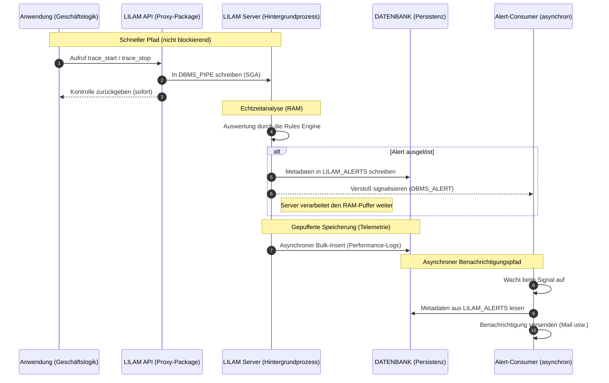

# Asynchrone Alerting-Architektur

[English](README.md) | **Deutsch**

## Überblick

Um einen hohen Durchsatz (> 2.500 EPS) zu halten, trennt LILAM die Analyse von Events strikt vom Versand der Benachrichtigungen. So können externe Latenzen (z. B. SMTP-Handshakes) die zentrale Verarbeitungsschleife nicht beeinträchtigen.

* **Reaktionsschnelligkeit (RAM zuerst):** LILAM gibt dem sofortigen Alert Vorrang vor der Speicherung. Alerts werden direkt aus der im RAM liegenden Rules Engine über [DBMS_ALERT] ausgelöst.
* **Pufferung für hohen Durchsatz:** Um > 2.500 EPS zu halten, ist die Speicherung der Events entkoppelt und gepuffert. Die Daten werden asynchron mit kontrollierter Verzögerung (bis 1,8 s) in die `MONITOR_TABLES` geschrieben, sodass Platten-I/O die Echtzeitanalyse nie ausbremst.

Damit kein Alert verloren geht, folgt LILAM dem Muster „erst schreiben, dann signalisieren“. Wird ein Regelverstoß erkannt, speichert der Server die Metadaten des Alerts sofort in der Tabelle `LILAM_ALERTS`, bevor er dem asynchronen Consumer ein Signal gibt. Das garantiert, dass der Consumer beim Aufwachen immer einen gültigen Datensatz vorfindet, und sichert hohe Zuverlässigkeit auch unter starker Last.

### Ablauf eines Alerts


> **Hinweis:** LILAM-Regeln sind nicht auf die Fehlererkennung beschränkt. Sie können auch positive fachliche Meilensteine verfolgen oder komplexe Event-Abfolgen prüfen (z. B. „Event B muss innerhalb von X Sekunden auf Event A folgen“).

---
## Konfiguration
Regeln legen fest, wie LILAM eingehende Signale prüft. Jede Regel nennt die Signalart, auf die sie reagiert (Trigger), die Action, für die sie gilt, eine Bedingung und den Alert, der ausgelöst wird, wenn die Bedingung erfüllt ist. Eine Regel kann ein Problem melden (Grenzwert überschritten), aber auch einen positiven Meilenstein oder die erwartete Reihenfolge von Events.

Regeln sind in Rule Sets organisiert, die als JSON-Dokumente in der Tabelle `LILAM_RULES` gespeichert werden. Ein Rule Set besteht aus einem Header und einem Array von Regeln.

> [!IMPORTANT]
> Regeln werden von LILAM **Servern** der Gruppe ausgewertet (Dispatcher werten keine Regeln aus) und von INSESSION-Prozessen, die mit `NEW_PROCESS(..., p_groupName => ...)` gestartet wurden. INSESSION-Prozesse ohne Gruppe haben keine Regeln. Siehe [Regeln im INSESSION-Modus](../docs/Architektur%20und%20Konzepte.md#regeln-im-insession-modus).

### Aufbau eines Rule Sets
| Eigenschaft | Typ | Pflicht | Beschreibung
| :-- | :-- | :-- | :--
| header | object | nein | Metadaten des Rule Sets
| header.rule_set | string | nein | Name des Rule Sets (nur zur Information; LILAM verwendet `LILAM_RULES.SET_NAME`)
| header.rule_set_version | number | nein | Version (nur zur Information; LILAM verwendet `LILAM_RULES.VERSION`)
| header.description | string | nein | für Menschen lesbarer Zweck oder Hinweise
| rules | array | ja | die einzelnen Regeldefinitionen (darf leer sein)
| rules.id | string | ja | eindeutige Kennung innerhalb des Rule Sets, max. 50 Zeichen (z. B. SEQ-001)
| rules.trigger_type | enum | ja | das Signal, das die Auswertung startet¹
| rules.action | string | ja² | Name der Action, des Events oder Prozesses, für den die Regel gilt, max. 100 Zeichen
| rules.context | string | nein | beschränkt die Regel auf einen Context der Action³, max. 100 Zeichen
| rules.condition.operator | enum | ja | die anzuwendende Prüfung (siehe [Operatoren](#operatoren))
| rules.condition.value | string | je nachdem | Parameter des Operators; Zahlen mit Dezimalpunkt (`0.5`)
| rules.condition.metric | string | nein | nur zur Information
| rules.alert.handler | string | ja | Name des `DBMS_ALERT`-Signals, auf das der Consumer wartet, max. 30 Zeichen
| rules.alert.severity | string | nein | an den Consumer übergebene Severity, max. 30 Zeichen
| rules.alert.throttle_seconds | number | nein | Mindestzahl an Sekunden, bevor dieselbe Regel für dieselbe Action, denselben Context und Baseline Scope erneut auslöst (Standard 0)⁴
| rules.windows | array | nein | nur `TIME_MAX_SILENCE_SECONDS`: Zeiten, in denen die Regel geprüft wird, siehe [Schweige-Regeln](#schweige-regeln)
| rules.time_zone | string | mit `windows` | Zeitzone der Fenster (Regionsname, z. B. `Europe/Berlin`)

¹ Der Trigger-Typ entspricht dem LILAM-API-Aufruf, der das Signal erzeugt hat, siehe [Hooks / Trigger-Typen](#hooks--trigger-typen).

² Bei Prozess-Triggern ist die Action der Prozessname. Bei `LOGGING`-Regeln kann die Action entfallen (sie ist immer `LOGGING`).

³ Der Context erlaubt unterschiedliche Grenzwerte für Instanzen derselben Action, z. B. ein Tempolimit nur für den Streckenabschnitt `SECTION_400_001`. Eine Regel mit Context gilt nur für diesen Context, eine Regel ohne Context gilt für **alle** Contexts der Action. Gibt es beide, werden beide ausgewertet.

⁴ Die Sperrfrist gilt je Regel, Action, Context und Baseline Scope (ohne Scope: je Prozess). Eine Regel ohne Context drosselt also jeden Context für sich: Ein Alert für `SAP` unterdrückt keinen für `SIE`. LILAM speichert die Sperre in der Tabelle `LILAM_ALERT_STATE`, sie gilt daher über Datenbanksessions, Pool-Verbindungen, Server-Worker und Neustarts hinweg; gleichzeitige Treffer in mehreren Sessions lösen nur einen Alert aus. Abgelaufene Sperren werden etwa einmal je Minute gelöscht.

```json
    {
      "id": "SEQ-003",
      "_comment": "Die Fahrt dauert nie länger als 25 Sekunden. Etwas hat den Zug gestoppt.",
      "trigger_type": "TRACE_STOP",
      "action": "TRACK_SECTION",
      "context": "SECTION_400_001",
      "condition": {
        "operator": "TIME_MAX_DURATION_MS",
        "value": "25000"
      },
      "alert": { "handler": "LILAM_ALERT_MAIL_LOG", "severity": "WARN", "throttle_seconds": 0 }
    }
```

Eigenschaften, deren Name mit `_` beginnt (z. B. `_comment`), werden ignoriert. Jede andere unbekannte Eigenschaft einer Regel, von `condition` oder von `alert` wird abgelehnt, damit ein Tippfehler wie `contxt` oder `throttle` nicht unbemerkt bleibt (der Header wird nicht geprüft).

### Prüfung beim Laden
Ein Server prüft ein Rule Set vollständig, bevor er es verwendet: Pflichtfelder, Längen, eindeutige IDs, bekannte Trigger-Typen und Operatoren, für den Trigger zulässige Operatoren und das Format von `condition.value`. Werte aus mehreren durch `|` getrennten Teilen dürfen keine leeren Teile enthalten: `|C1`, `A|` und `20||0.3` werden abgelehnt statt anders gelesen, und Operatoren, die eine einzelne Zahl erwarten, lehnen zusätzliche Teile ab (`|5`, `5|x`). Felder müssen Texte oder Zahlen sein: Ein Objekt, ein Array oder ein Text über 4000 Zeichen wird abgelehnt, ebenso unbekannte Eigenschaften (siehe oben). Ist eine einzige Regel ungültig, wird das **gesamte** Rule Set abgelehnt, und die zuvor geladenen Regeln bleiben aktiv. `SERVER_UPDATE_RULES` führt dieselbe Prüfung durch, bevor es ein Rule Set aktiviert, und wirft eine Exception mit der Begründung; ein Server, der ein Rule Set beim Start ablehnt, schreibt die Begründung in `LILAM_LOG_INTERNAL` und in das Log des Serverprozesses.

Um ein Rule Set zu prüfen, bevor Du es speicherst oder aktivierst, rufe `LILAM.CHECK_RULE_SET(p_ruleSet)` auf. Die Funktion führt dieselbe Prüfung durch und liefert `NULL`, wenn das Rule Set gültig ist, sonst die Begründung (sie wirft nie eine Exception).

### Hooks / Trigger-Typen
| Hook | Bereich | API-Aufruf
| :-- | :-- | :--
| PROCESS_START | Prozess | `NEW_PROCESS` / `SERVER_NEW_PROCESS`
| PROCESS_UPDATE | Prozess | `SET_PROCESS_STATUS`, `SET_PROC_STEPS_TODO`, `SET_PROC_STEPS_DONE`, `PROC_STEP_DONE`, ...
| PROCESS_STOP | Prozess | `CLOSE_PROCESS` (sieht die an `CLOSE_PROCESS` übergebenen Werte)
| MARK_EVENT | Event | `MARK_EVENT`
| TRACE_START, TRACE_STOP | Transaktion | `TRACE_START`, `TRACE_STOP`
| LOGGING | Logging | `ERROR`, `WARN`, `INFO`, `DEBUG`, ...

Regeln auf `MARK_EVENT` und `TRACE_STOP` werden nur ausgewertet, wenn der Log-Level des Prozesses mindestens `logLevelMonitor` ist; bei einem niedrigeren Level (z. B. `logLevelWarn`) werden diese Signale samt Regeln ignoriert. `TRACE_START`- und `LOGGING`-Regeln werden unabhängig vom Log-Level ausgewertet; eine `LOGGING`-Regel löst auch bei Meldungen aus, die wegen des Log-Levels nicht ins Log geschrieben werden.

### Operatoren
| Operator | Wert | zulässige Trigger | löst aus, wenn
| :-- | :-- | :-- | :--
| ON_START, ON_STOP, ON_EVENT, ON_UPDATE | – | alle außer LOGGING | immer (der Trigger selbst ist die Bedingung)
| SEVERITY | `ERROR`, `WARN`, `MONITOR`, `INFO`, `DEBUG` | LOGGING | eine Log-Meldung genau dieses Levels eintrifft
| LOG_CONTAINS | `TEXT` oder `LEVEL\|TEXT` | LOGGING | eine Log-Meldung den Text enthält (ohne Unterscheidung von Groß-/Kleinschreibung), wahlweise nur für diesen Level (`ERROR`, `WARN`, `MONITOR`, `INFO`, `DEBUG`; sonst ist der ganze Wert der Text)
| TIME_MAX_DURATION_MS | Millisekunden | MARK_EVENT, TRACE_STOP | die Dauer des Trace, bei Events die Zeit seit dem vorherigen Event derselben Action, größer als der Wert ist
| TIME_EWMA_DEVIATION_PCT_UP | `pct[\|warmup[\|alpha]]` | MARK_EVENT, TRACE_STOP | die Dauer mehr als `pct` Prozent über dem gleitenden Durchschnitt (EWMA) liegt; keine Auswertung, solange der Durchschnitt unter 1 ms liegt (Messauflösung), siehe unten
| TIME_EWMA_DEVIATION_PCT_DOWN | `pct[\|warmup[\|alpha]]` | MARK_EVENT, TRACE_STOP | die Dauer mehr als `pct` Prozent unter dem gleitenden Durchschnitt (EWMA) liegt; dieselbe 1-ms-Ausnahme
| VAL_EWMA_DEVIATION_PCT_UP | `pct[\|warmup[\|alpha]]` | MARK_EVENT | der Messwert (`p_value`) über `EWMA + \|EWMA\| * pct / 100` liegt; Events ohne Wert lösen nichts aus
| VAL_EWMA_DEVIATION_PCT_DOWN | `pct[\|warmup[\|alpha]]` | MARK_EVENT | der Messwert unter `EWMA - \|EWMA\| * pct / 100` liegt
| VAL_MIN | Zahl | MARK_EVENT | der Messwert kleiner als der Wert ist (fester Grenzwert)
| VAL_MAX | Zahl | MARK_EVENT | der Messwert größer als der Wert ist (fester Grenzwert)
| VAL_CROSS_ABOVE | `schwelle[\|rückkehr]` | MARK_EVENT | der Wert über die Schwelle steigt: ein Alert, danach still, bis er zurückgekehrt ist, siehe [Schwellen-Regeln](#schwellen-regeln)
| VAL_CROSS_BELOW | `schwelle[\|rückkehr]` | MARK_EVENT | der Wert unter die Schwelle fällt: ein Alert, danach still, bis er zurückgekehrt ist, siehe [Schwellen-Regeln](#schwellen-regeln)
| MAX_OCCURRENCE | Anzahl | MARK_EVENT, TRACE_STOP, PROCESS_UPDATE, PROCESS_STOP | die Action innerhalb des Prozesses öfter als der Wert vorkam (`ACTION_COUNT`); bei Prozessen: `STEPS_DONE` > Wert
| TIME_MAX_GAP_SECONDS | Sekunden | MARK_EVENT, TRACE_START | die Zeit seit dem vorherigen Event (MARK_EVENT) bzw. seit dem Ende des vorherigen Trace (TRACE_START) derselben Action größer als der Wert ist
| TIME_MAX_SILENCE_SECONDS | Sekunden (> 0) | PROCESS_START, MARK_EVENT, TRACE_START, PROCESS_UPDATE | länger als der Wert kein Signal eintraf; zeitgesteuert geprüft, nicht durch ein Signal, siehe [Schweige-Regeln](#schweige-regeln)
| PRECEDED_BY | `ACTION` oder `ACTION\|CONTEXT` | MARK_EVENT, TRACE_START, PROCESS_UPDATE, PROCESS_STOP | das vorherige Signal des Prozesses **nicht** die erwartete Action war (und, falls angegeben, der erwartete Context)⁴
| TIME_PRECEDED_BY_WITHIN_SECS | `ACTION\|SECONDS` oder `ACTION\|CONTEXT\|SECONDS` | wie PRECEDED_BY | wie PRECEDED_BY, oder der erwartete Vorgänger vor mehr als den angegebenen Sekunden endete
| TIME_RUNTIME_EXCEEDED | Millisekunden | PROCESS_UPDATE | der laufende Prozess älter als der Wert ist
| TIME_MAX_RUNTIME_EXCEEDED | Millisekunden | PROCESS_STOP | die Gesamtlaufzeit des Prozesses größer als der Wert ist
| STEPS_LEFT_HIGH | Anzahl | PROCESS_START, PROCESS_UPDATE, PROCESS_STOP | `STEPS_TODO - STEPS_DONE` > Wert
| SUCCESS_RATE_LOW | Prozent | PROCESS_START, PROCESS_UPDATE, PROCESS_STOP | `STEPS_DONE / STEPS_TODO * 100` < Wert
| STATUS_EQUALS | Zahl | PROCESS_START, PROCESS_UPDATE, PROCESS_STOP | Prozessstatus = Wert
| INFO_CONTAINS | Text | PROCESS_START, PROCESS_UPDATE, PROCESS_STOP | die Prozessinformation den Text enthält (ohne Unterscheidung von Groß-/Kleinschreibung)

Benennung: Operatoren, die Zeiten bewerten (Event-Abstände, Trace-Dauern, Prozesslaufzeiten), beginnen mit `TIME_`, Operatoren für Messwerte aus `MARK_EVENT(p_value)` mit `VAL_`. Operatoren, die Reihenfolge, Anzahl, Status oder Text prüfen, haben kein Präfix.

Die EWMA-Abweichungsoperatoren vergleichen mit dem EWMA **vor** der aktuellen Messung, damit ein neuer Ausreißer nicht seinen eigenen Vergleichswert abschwächt. `_UP` und `_DOWN` derselben Reihe teilen sich `warmup` und `alpha`; gib beiden dieselben Werte. Zeit- und Wertreihe einer Kombination aus Action und Context sind getrennt: `TIME_`-Regeln sehen nie den Messwert, `VAL_`-Regeln nie den zeitlichen Abstand.

⁴ Als Vorgänger zählen nur Events und Traces (Start und Stopp), keine Log-Meldungen. Ohne Context im Wert wird jeder Context der erwarteten Action akzeptiert. Die Reihenfolge wird geprüft, wenn die Action startet, nicht bei TRACE_STOP (dort wäre der Vorgänger meist das eigene TRACE_START); beim Laden wird `PRECEDED_BY*` mit TRACE_STOP abgelehnt.

> [!NOTE]
> Alle anderen Regeln werden ausgewertet, wenn ein Signal eintrifft. Die Reihenfolge „B folgt innerhalb von X Sekunden auf A“ lässt sich beim Eintreffen von B prüfen, mit `TIME_PRECEDED_BY_WITHIN_SECS` auf B. Signale, die gar nicht eintreffen, decken die Schweige-Regeln unten ab.

### Schwellen-Regeln

`VAL_MIN` und `VAL_MAX` haben keinen Zustand: Jeder Wert jenseits der Grenze ist ein Verstoß, und nur `throttle_seconds` schafft Abstand zwischen den Alerts. Ein Wert, der jenseits der Grenze bleibt, wird nach jeder Sperrfrist erneut gemeldet. `VAL_CROSS_ABOVE` und `VAL_CROSS_BELOW` melden **einmal**, wenn die Schwelle überquert wird, und sind erst wieder scharf, nachdem der Wert zurückgekehrt ist.

```json
{
  "id": "SAP-MAX",
  "trigger_type": "MARK_EVENT",
  "action": "SHARE_PRICE",
  "context": "SAP",
  "condition": { "operator": "VAL_CROSS_ABOVE", "value": "185|180" },
  "alert": { "handler": "MAIL", "severity": "WARN", "throttle_seconds": 0 }
}
```

| Zustand | Wert | Wirkung |
| --- | --- | --- |
| scharf | jenseits der Schwelle (`ABOVE`: `Wert > Schwelle`, `BELOW`: `Wert < Schwelle`) | Alert, Regel ist ausgelöst |
| ausgelöst | zurückgekehrt (`ABOVE`: `Wert <= Rückkehr`, `BELOW`: `Wert >= Rückkehr`) | wieder scharf, **kein Alert** |
| jeder andere Fall | | nichts |

- **Wert:** `schwelle` oder `schwelle|rückkehr` (Hysterese). Ohne Rückkehrgrenze entspricht sie der Schwelle. Bei `ABOVE` darf die Rückkehrgrenze nicht über der Schwelle liegen, bei `BELOW` nicht darunter.
- **Reihe:** Der Zustand gilt je Gruppe, Baseline Scope (ohne Scope: Prozess), Regel, Action und Context. Eine Regel ohne Context führt also einen Zustand je Context.
- **Erster Wert:** Eine Reihe ohne Zustand ist scharf. Liegt ihr erster Wert bereits jenseits der Schwelle, löst die Regel aus.
- **Dauerhaft:** Der Zustand steht in `LILAM_ALERT_STATE` und gilt über Sessions, Prozesse des Scopes und Server-Neustarts hinweg. Zustand und Alert werden gemeinsam committet; von mehreren Sessions löst nur eine aus, und scheitert das Schreiben des Alerts, bleibt die Regel scharf.
- **Ohne Scope** (`#NONE`) gilt der Zustand je Prozess und endet mit ihm: Jeder Lauf meldet neu. Für das Überqueren über Läufe hinweg ist ein Scope nötig. Schließt ein Prozess ohne Scope nie, wird seine Zeile nach 30 Tagen gelöscht.
- **`throttle_seconds`:** Unterdrückt eine Sperrfrist den Alert, bleibt die Regel scharf und löst nach Ablauf der Frist aus, wenn der Wert dann noch jenseits der Schwelle liegt. Es geht kein Verstoß verloren.
- **Geänderte Regel:** Der Zustand merkt sich Operator und Grenzen. Passen sie nicht mehr zur Regel, gilt die Regel als scharf. Eine neue Rule-Set-Version, in der diese Regel unverändert ist, behält den Zustand. Solange Sessions noch die alten Regeln halten (bis etwa 15 s), können zwei Sessions, die dieselbe Reihe melden, zusätzliche Alerts auslösen.
- **`RESET_BASELINE`** löscht den Zustand der Reihe, für alle Regeln und Gruppen des Scopes.
- **Entfernte Regeln:** `SERVER_UPDATE_RULES` löscht den Zustand von Regeln, die nicht mehr im Rule Set stehen; kommt die Regel zurück, beginnt sie scharf.
- **Mehrere Quellen einer Reihe:** Melden zwei Sessions gegenläufige Werte, gewinnt der zuletzt committete Zustandswechsel. Eine globale Reihenfolge der Signale gibt es nicht.
- **Kosten:** Ein Wert jenseits der Schwelle oder ein zurückgekehrter Wert kostet einen Lesezugriff auf `LILAM_ALERT_STATE` je Regel, ein Wert zwischen Rückkehrgrenze und Schwelle keinen. Rule Sets ohne diese Operatoren lesen die Tabelle nicht.

### Schweige-Regeln

`TIME_MAX_SILENCE_SECONDS` meldet, dass ein Signal länger als der Wert **nicht** eingetroffen ist. Das ist die Grundlage für einen Watchdog der Anwendung: LILAM erkennt und meldet das Schweigen; Planung der Prüfung und Überwachung des Prüfers bleiben bei der Anwendung. Der Trigger-Typ wählt aus, was schweigen muss:

| trigger_type | Schweigen, wenn | Alert |
| --- | --- | --- |
| PROCESS_START | kein Prozess namens `action` gestartet wurde | `process_id` NULL (kein Prozess), `process_name` = `action` |
| MARK_EVENT, TRACE_START | kein Event bzw. Trace-Start von `action` eintraf; mit `context` nur für diesen Context, ohne `context` zählt jeder Context | `process_id` NULL, `action`/`context` der Regel |
| PROCESS_UPDATE | ein laufender Prozess namens `action` nichts gesendet hat (Log, Event, Trace, Status) | `process_id` des Prozesses |

```json
{ "id": "POLL-SILENT", "trigger_type": "PROCESS_START", "action": "SPM_POLL",
  "condition": { "operator": "TIME_MAX_SILENCE_SECONDS", "value": "900" },
  "alert": { "handler": "LILAM_ALERT_MAIL_LOG", "severity": "ERROR", "throttle_seconds": 3600 } }
```

- **Geltungsbereich:** je Regelgruppe, über alle Prozesse, Sessions und Server der Gruppe hinweg (auch Prozesse ohne Baseline Scope). Prozess-Trigger nehmen keinen `context`.
- **Wer prüft:** jeder Server der Gruppe alle 10 Sekunden. Ohne Server (nur In-Session) ruft die Anwendung `LILAM.CHECK_SILENCE(p_groupName)` auf, z. B. aus einem eigenen `DBMS_SCHEDULER`-Job. Mehrere Prüfer lösen nur einen Alert aus.
- **Start:** Ein Ziel ohne bisheriges Signal zählt ab der ersten Prüfung nach dem Aktivieren der Regel. So wird ein Job gemeldet, der nie startet, aber das Aktivieren einer Regel löst nicht sofort einen Alert aus.
- **Wiederholung:** Solange das Schweigen anhält, steuert `throttle_seconds` die Wiederholungen über Sessions und Prüfer hinweg; mit `throttle_seconds` 0 ist die Schweigezeit die Sperrfrist. Bei wiederkehrenden Signalen gibt es keinen Alert.
- **„Zuletzt gesehen“** wird je Gruppe und Ziel in `LILAM_ALERT_STATE` gespeichert und übersteht Neustarts. Maßgeblich ist der Zeitpunkt der Verarbeitung (Server: wenn der Worker die Nachricht bearbeitet).
- **Grenzen:** Signale werden gepuffert etwa alle 1,5 Sekunden geschrieben (In-Session: am nächsten Schreibpunkt der Session, spätestens bei `CLOSE_PROCESS`); zusammen mit dem Prüfintervall wird ein Schweigen bis zu etwa 12 Sekunden (Server) bzw. ein Job-Intervall verspätet gemeldet. Schweigezeiten sollten daher deutlich darüber liegen. Ein Prozess, der ohne `CLOSE_PROCESS` endet (Session beendet), behält seinen Eintrag und wird als schweigend gemeldet, bis die Regel entfernt wird. Geänderte Rule Sets erreichen die Prüfer wie bei anderen Regeln (Server sofort oder nach 15 s, In-Session-Prüfer beim nächsten Aufruf); Einträge ohne Regel werden entfernt.
- **Den Prüfer überwachen:** Läuft kein Prüfer (Server gestoppt, Job deaktiviert), wird nichts gemeldet. Das kann LILAM nicht selbst erkennen; die Anwendung überwacht ihren Job in `DBMS_SCHEDULER` (Zustand, Fehler) oder einen zweiten, unabhängigen Prüfer.
- **Zeitfenster** (optional): `windows` beschränkt die Prüfung auf Tageszeiten, z. B. Handelszeiten. Außerhalb aller Fenster wird nichts gemeldet. Öffnet ein Fenster, zählt das Schweigen ab seiner Öffnung, sodass das letzte Signal vom Vorabend um 09:00 keinen Alert auslöst (auch nach einer Pause zwischen zwei Fenstern). Mehrere Fenster sind erlaubt; die Regel wird geprüft, solange mindestens eines offen ist (überlappende Fenster addieren sich einfach). `time_zone` (Regionsname wie `Europe/Berlin`, auch über die Sommerzeit hinweg) gilt für alle Fenster der Regel und ist mit `windows` Pflicht. Feiertage bleiben Sache der Anwendung.

  ```json
  { "id": "SAP-SILENT", "trigger_type": "MARK_EVENT", "action": "SHARE_PRICE", "context": "SAP",
    "condition": { "operator": "TIME_MAX_SILENCE_SECONDS", "value": "3600" },
    "windows": [ { "days": "MON-FRI", "from": "09:00", "to": "13:00" },
                 { "days": "MON-FRI", "from": "15:00", "to": "19:00" } ],
    "time_zone": "Europe/Berlin",
    "alert": { "handler": "LILAM_ALERT_MAIL_LOG", "severity": "WARN", "throttle_seconds": 3600 } }
  ```

  | Schlüssel | Inhalt |
  | --- | --- |
  | `days` | `MON`…`SUN`, Bereiche und Listen: `MON-FRI`, `MON,WED,FRI`, `FRI-MON` (über das Wochenende hinweg) |
  | `from`, `to` | `HH:MI` (24 h); `to` darf `24:00` sein. `to` vor `from` bedeutet über Mitternacht: Das Fenster beginnt an einem genannten Tag und endet am Folgetag (`22:00`–`06:00`) |

---
## Tabelle: LILAM_RULES
Diese Tabelle ist die zentrale Ablage aller Rule Sets. Jedes Rule Set wird als versioniertes JSON-Dokument für eine **Gruppe** gespeichert (Servergruppe oder `p_groupName` von `NEW_PROCESS`); dasselbe Rule Set kann für mehrere Gruppen gespeichert sein. Je Gruppe ist genau eine Zeile aktiv.

| Spalte | Typ | Beschreibung |
| :--- | :--- | :--- |
| **GROUP_NAME** | `VARCHAR2(50)` | Gruppe, zu der das Rule Set gehört (Servergruppe oder `p_groupName` von `NEW_PROCESS`); Pflicht. |
| **SET_NAME** | `VARCHAR2(30)` | Name des Rule Sets; Pflicht. `GROUP_NAME` (ohne Unterscheidung von Groß- und Kleinschreibung), `SET_NAME` und `VERSION` sind zusammen eindeutig. |
| **VERSION** | `NUMBER` | Ganzzahlige Version zur Unterstützung von Tests, Staging und Rollbacks; Pflicht. |
| **IS_ACTIVE** | `NUMBER(1)` | `1` für das Rule Set, das die Server und INSESSION-Prozesse der Gruppe verwenden (höchstens eines je Gruppe), sonst `0`. |
| **RULE_SET** | `CLOB` | Das JSON-Dokument (Header und Regeln); geprüft durch `IS JSON`. |
| **CREATED** | `TIMESTAMP` | Zeitpunkt, zu dem diese Version angelegt wurde. |
| **AUTHOR** | `VARCHAR2(50)` | Entwickler oder Architekt, der das Rule Set definiert hat. |

Alerts und der Consumer verweisen über `GROUP_NAME`, `SET_NAME`, `VERSION` und `rules.id` auf eine Regel.

> **Hinweis zur Implementierung**
> Die LILAM Server laden das aktive Rule Set ihrer Gruppe beim Start (oder beim Aufruf von `SERVER_UPDATE_RULES`) in den RAM. INSESSION-Prozesse mit Gruppe laden es bei ihrer ersten Regelprüfung und suchen danach höchstens alle 15 Sekunden nach einem neuen aktiven Rule Set. Alle Regelauswertungen arbeiten auf dieser zwischengespeicherten Struktur, ohne Datenbankzugriff. Nur eine auslösende Regel schreibt in `LILAM_ALERTS`.

---
## Ein Rule Set laden

`SERVER_UPDATE_RULES` prüft das Rule Set der Gruppe, macht es zum aktiven und weist jeden laufenden Server der Gruppe (außer Dispatchern) an, es neu zu laden. Eine Gruppe ohne laufende Server ist kein Fehler: Jeder Server lädt beim Start das aktive Rule Set seiner Gruppe, auch neu hinzukommende Server. INSESSION-Prozesse der Gruppe übernehmen die Änderung bei ihrem ersten API-Aufruf nach höchstens 15 Sekunden.

```sql
INSERT INTO LILAM_RULES (group_name, set_name, version, created, author, rule_set)
VALUES ('METRO', 'METRO_RULES', 2, systimestamp, 'Dirk', '{"rules":[ ... ]}');

exec LILAM.SERVER_UPDATE_RULES(p_groupName => 'METRO', p_ruleSetName => 'METRO_RULES', p_ruleSetVersion => 2);
```

Ein fehlendes oder ungültiges Rule Set löst `NUM_ERR_RULE_SET` (-20130) mit der Begründung aus; es ändert sich nichts.

---

## Performance
Regeln werden im RAM ausgewertet, das ist günstig: Regeln für andere Actions kosten nichts Messbares, etwa 6 µs je Signal für jede Regel derselben Action. Eine **auslösende** Regel kostet mehrere Millisekunden (Insert in `LILAM_ALERTS`, Commit, `DBMS_ALERT.SIGNAL`). Verwende `throttle_seconds` für Regeln, die häufig auslösen können.

### Vertiefung: Anomalieerkennung mit EWMA

Die Operatoren `TIME_EWMA_DEVIATION_PCT_*` und `VAL_EWMA_DEVIATION_PCT_*` nutzen einen **exponentiell gewichteten gleitenden Durchschnitt (EWMA)**. Anders als ein einfaches arithmetisches Mittel gewichtet der EWMA neuere Datenpunkte stärker, sodass sich das System in Echtzeit an veränderte Performance-Trends anpasst.

#### Was ist EWMA?
Ein statistisches Maß zur Modellierung von Zeitreihen. In LILAM bildet es eine „mitlaufende Baseline“ für Deine Geschäftstransaktionen. Weicht ein neues Event deutlich von dieser Baseline ab, wird ein Alert ausgelöst.

#### Technisches Beispiel: `20|100|0.1`
Bei `TIME_EWMA_DEVIATION_PCT_UP` mit dem Wert `20|100|0.1` haben die Parameter diese Bedeutung:


| Parameter | Wert | Beschreibung |
| :--- | :--- | :--- |
| **Toleranz** | `20` | Alert, wenn die Abweichung vom Durchschnitt > 20 % ist. |
| **Warm-up** | `100` | Mindestanzahl anfänglicher Events, um eine stabile Baseline aufzubauen, bevor Alerts möglich sind. |
| **Glättung (Alpha)** | `0.1` | Das Gewicht des neuesten Events (10 %). Ein kleinerer Wert macht den Durchschnitt stabiler, ein größerer lässt ihn stärker auf plötzliche Änderungen reagieren. |


Fehlen `warmup` oder `alpha`, verwendet LILAM Warm-up 3 und Alpha 0,1. Während des Warm-ups löst die Regel nicht aus.

#### Beispiel: Überwachung eines Aktienkurses

Die Anwendung meldet den Kurs mit `lilam.mark_event(l_pid, 'SHARE', 'ARAL', 80.71)`. Diese Regeln lösen bei einem Sprung von mehr als 5 % gegenüber dem EWMA in beide Richtungen einen Alert aus und wenn der Kurs das Band von 60 bis 120 verlässt:

```json
{ "id": "ARAL-UP",   "trigger_type": "MARK_EVENT", "action": "SHARE", "context": "ARAL",
  "condition": { "operator": "VAL_EWMA_DEVIATION_PCT_UP",   "value": "5|20|0.2" },
  "alert": { "handler": "LILAM_ALERT_MAIL_LOG", "severity": "WARN", "throttle_seconds": 300 } },
{ "id": "ARAL-DOWN", "trigger_type": "MARK_EVENT", "action": "SHARE", "context": "ARAL",
  "condition": { "operator": "VAL_EWMA_DEVIATION_PCT_DOWN", "value": "5|20|0.2" },
  "alert": { "handler": "LILAM_ALERT_MAIL_LOG", "severity": "WARN", "throttle_seconds": 300 } },
{ "id": "ARAL-MIN",  "trigger_type": "MARK_EVENT", "action": "SHARE", "context": "ARAL",
  "condition": { "operator": "VAL_MIN", "value": "60" },
  "alert": { "handler": "LILAM_ALERT_MAIL_LOG", "severity": "ERROR" } },
{ "id": "ARAL-MAX",  "trigger_type": "MARK_EVENT", "action": "SHARE", "context": "ARAL",
  "condition": { "operator": "VAL_MAX", "value": "120" },
  "alert": { "handler": "LILAM_ALERT_MAIL_LOG", "severity": "ERROR" } }
```

`throttle_seconds` begrenzt wiederholte Alerts, ist aber keine Hysterese: Nach Ablauf der Sperrfrist löst der nächste Wert außerhalb des Bandes den nächsten Alert aus.
